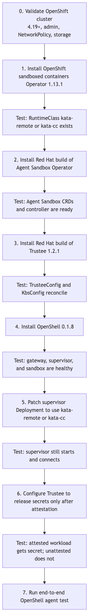
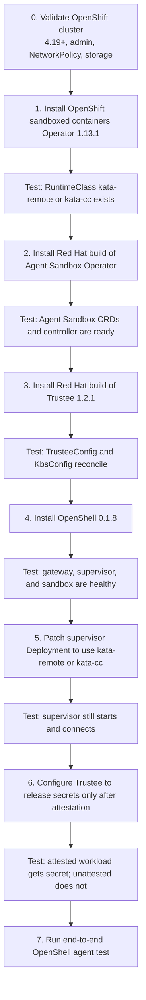

# OpenShell Confidential Container Stack

Deploy the **OpenShell supervisor inside a confidential container** on OpenShift, with attestation-gated secret release through **Red Hat build of Trustee**.

This repository is a PoC deployment and test harness. It is intentionally small and sequential: each phase has a deploy step and a test gate.

## Target versions

| Component | Version / status |
|---|---|
| OpenShift Container Platform | 4.19 or later |
| OpenShift sandboxed containers | **1.13.1** |
| Red Hat build of Agent Sandbox Operator | **Technology Preview**, shipped with OpenShift sandboxed containers 1.13 |
| Red Hat build of Trustee | **1.2.1** |
| OpenShell | **0.1.8** |

## Deployment order





**Order matters for the first deployment.** After the baseline works, Trustee, Agent Sandbox, and OpenShell chart preparation can be done in parallel.

## Repository layout

```text
openshell-coco-stack/
├── README.md
├── Makefile
├── deploy/
│   ├── 00-namespaces.yaml
│   ├── 01-openshift-sandboxed-containers-operator.yaml
│   ├── 02-agent-sandbox-operator.yaml
│   ├── 03-trustee-operator.yaml
│   ├── 04-openshell-values.yaml
│   └── 05-supervisor-runtimeclass-patch.yaml
├── config/
│   ├── openshell-values.yaml
│   ├── trustee-config.yaml
│   └── kbs-config.yaml
├── tests/
│   ├── 01-cluster.sh
│   ├── 02-runtimeclass.sh
│   ├── 03-agent-sandbox.sh
│   ├── 04-trustee.sh
│   ├── 05-openshell.sh
│   └── 06-end-to-end.sh
└── docs/
    ├── deployment-sequence.md
    └── deployment-sequence.png
```

## Quick start

```bash
make deploy
make test
```

The Makefile runs each phase in order and stops on the first failure.

## Security claim

This stack protects the **OpenShell supervisor’s in-use state and credentials** by running it inside a confidential VM and releasing secrets only after successful attestation.

It does **not** by itself protect secrets that remain outside the confidential VM, such as secrets stored in the gateway, Kubernetes, or Vault.

## Important implementation note

The OpenShell Helm chart does not expose a `runtimeClassName` field for the shared supervisor Deployment. To avoid modifying OpenShell, this repo:

1. sets `gatewayConfig.openshell.drivers.kubernetes.supervisor_topology: gateway`, which makes the supervisor a chart-managed Deployment;
2. patches that Deployment with `runtimeClassName: kata-remote` or `kata-cc`.

That is a configuration-only path and requires no OpenShell code changes.
