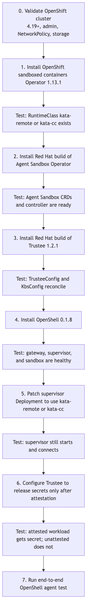

# Deployment sequence



## Phase 0 — Cluster readiness

Before installing the chart, verify:

- OpenShift 4.19 or later
- cluster-admin or equivalent RBAC
- a CNI that enforces ingress and egress NetworkPolicy
- a default or named StorageClass
- confidential VM SKU or peer-pod support
- Azure quota, region, and identity configuration if using ARO

```bash
oc get clusterversion
oc get nodes
oc get storageclass
```

## Phase 1 — Render and install the Helm chart

Install or upgrade the umbrella release:

```bash
helm upgrade --install openshell-coco \
  chart/openshell-coco-supervisor \
  --namespace openshell \
  --create-namespace \
  --wait
```

The chart renders and installs:

- OpenShift sandboxed containers Operator
- Agent Sandbox Operator
- Red Hat build of Trustee
- the confidential Kata runtime
- OpenShell
- the supervisor initdata hook
- the confidential supervisor Deployment

## Phase 2 — Idempotency and skip behavior

The umbrella chart uses Helm `lookup` during rendering.

For each operator, CRD, KataConfig, TrusteeConfig, and KbsConfig:

- if the resource is missing, Helm renders it;
- if the resource already exists and is owned by this release, Helm renders and updates it;
- if the resource already exists and is owned by another manager, Helm skips it.

This prevents duplicate subscriptions and custom resources on clusters where some components are already installed.

## Phase 3 — Initdata hook

Before the main resources are applied, the chart runs a pre-install and pre-upgrade hook Job.

On a greenfield cluster where Trustee is not installed yet, disable this hook on the first install with:

```bash
--set initdata.enabled=false \
  --set openshell.supervisor.initdataConfigMap=""
```

After Trustee is available, enable it again on the next upgrade.

The hook:

1. reads the Trustee certificate,
2. builds `initdata.toml`,
3. compresses and base64-encodes it,
4. creates the `openshell-supervisor-initdata` ConfigMap.

Kyverno then injects that initdata into the supervisor Pod as:

```text
io.katacontainers.config.hypervisor.cc_init_data
```

## Phase 4 — Confidential supervisor

The vendored OpenShell subchart renders the shared supervisor Deployment with:

```yaml
runtimeClassName: kata-remote

annotations:
  io.katacontainers.config.hypervisor.default_memory: "2048"
  coco.io/initdata-configmap: "openshell-supervisor-initdata"

resources:
  requests:
    memory: "2560Mi"
  limits:
    memory: "2560Mi"
```

## Phase 5 — Verify the deployment

```bash
make test
```

The tests validate:

- cluster readiness,
- OpenShift sandboxed containers,
- Agent Sandbox,
- Trustee,
- OpenShell,
- the confidential supervisor,
- the end-to-end deployment.

## Phase 6 — End-to-end workflow

After the deployment is healthy:

1. create an OpenShell sandbox,
2. run an agent command,
3. request an approved external endpoint,
4. verify policy blocks unauthorized network and filesystem access,
5. verify credentials are not visible to the agent.

## Rollback

```bash
helm uninstall openshell-coco -n openshell
```

This removes resources owned by the Helm release. Resources skipped because they were already owned by another manager are not removed.
